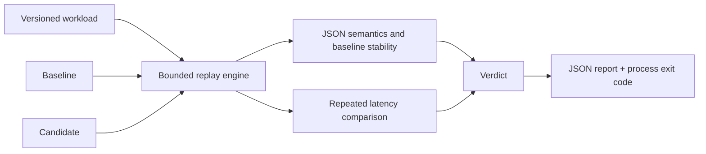

# DeployGuard: making an API regression block a release

[Source](https://github.com/AddysEdge/deployguard) · [Download a binary](https://github.com/AddysEdge/deployguard/releases/latest) · [CI](https://github.com/AddysEdge/deployguard/actions/workflows/ci.yml)

## Problem

A service can remain reachable while a release removes a JSON field, changes a response type or becomes
substantially slower. A health endpoint alone does not exercise those client-facing contracts.

DeployGuard is a Go CLI that sends a declared GET/HEAD workload to baseline and candidate services.
It produces a terminal decision, a versioned JSON report and an exit code a CI pipeline can enforce.

## Design

JSON object key order is ignored, while structural and type changes can block a release.
An unreliable baseline produces an inconclusive result instead of a reassuring pass.
The gate retains a failure outcome even when the displayed finding list reaches its size cap.

Performance gating repeats a comparison with reversed target order and requires the configured
thresholds to be breached. These are operational thresholds, not a statistical significance claim.

## Evidence

[View a recorded demo and its unedited reports](https://github.com/AddysEdge/deployguard/tree/main/docs/demo).

The [published-binary demo](https://github.com/AddysEdge/deployguard/actions/workflows/published-demo.yml)
downloads a checksummed release and runs that executable against two small loopback APIs.
Harmless JSON key reordering must pass; removing an email field must fail and be identified in the report.
It records the actual transcript and JSON reports for Linux, Windows and macOS.

A separate [seeded evaluation](https://github.com/AddysEdge/deployguard/tree/main/examples/eval)
covers additional regression, no-regression and untrustworthy-baseline cases.
Its results describe those fixtures, not general detection accuracy.

## Trade-offs and scope

The tool is intentionally bounded to declared GET/HEAD workloads. It does not capture production traffic,
simulate browser interactions or prove business correctness. Reports omit raw bodies and request-header values,
but paths and object-key names still require care when testing sensitive APIs.

## Try it

After extracting a release bundle, run `deployguard version` and
`deployguard validate --config deployguard.yaml`. The
[download guide](https://github.com/AddysEdge/deployguard/blob/main/docs/downloads.md) includes
a complete comparison, cleanup commands and the foreground Node.js demo.
