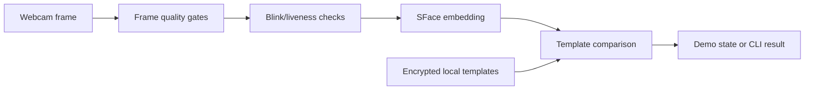

# FaceAuth: checking privacy boundaries in a local prototype

[Source](https://github.com/AddysEdge/ai-face-auth) · [Tests](https://github.com/AddysEdge/ai-face-auth/actions/workflows/ci.yml) · [CodeQL](https://github.com/AddysEdge/ai-face-auth/actions/workflows/codeql.yml)

## Problem

An offline face-authentication prototype needs more than a matching score.
Unusable frames, spoof attempts, sensitive template storage and unexpected dependency network traffic
all affect what the prototype can honestly claim.

## Design

The pipeline runs on the CPU. Windows DPAPI protects stored templates, model artifacts are checksum-pinned,
and errors are handled without granting access. DPAPI protects stored data under a Windows account;
it does not protect against an attacker who already controls that account or the running process.

## Engineering decision: verify the offline claim

The project investigated telemetry in its original MediaPipe runtime instead of assuming that local inference
implied no network activity. It replaced that runtime with a LiteRT-based implementation while retaining pinned
model weights and documenting preprocessing corrections.

The [B17 investigation](https://github.com/AddysEdge/ai-face-auth/blob/main/docs/PHASE2_5_B17_RESEARCH.md)
records fresh-process network observations and the limits of the synthetic comparison.
Network silence and liveness-detection quality are separate claims: evidence for the first does not validate
the second.

## Evidence and limits

CI covers Python behavior, native scaffold builds, repository hygiene and dependency checks.
CodeQL analyzes Python and C++. These checks support implementation review; they are not measured
false-accept/false-reject rates.

Real-input validation of the replacement liveness path remains open under B18.
The prototype does not defend against video replay and does not integrate with Windows sign-in.
The native scaffold is inert; it is not an installed Credential Provider or service.

See the [threat model](https://github.com/AddysEdge/ai-face-auth/blob/main/docs/THREAT_MODEL.md)
for implemented mitigations and residual risks.

## Try it

Follow the repository's Python 3.12 setup, model-download and enrollment instructions, then use its CLI
or Tkinter demo. A live camera recording needs a consenting participant and should avoid exposing
stored templates or private environment details. No camera or biometric data was used to write this case study.
