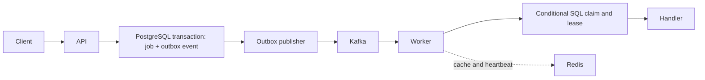

# TaskForge: recovering work after a process crash

[Source](https://github.com/AddysEdge/Task_forge) · [Build and integration tests](https://github.com/AddysEdge/Task_forge/actions/workflows/ci.yml)

## Problem

A job API can acknowledge a request and still lose the notification that a worker needs.
A worker can also crash after taking a job, and a message broker can deliver the same message twice.
TaskForge explores these failure cases with a Spring Boot API, independent workers and real infrastructure integration tests.

## Design



The job row and announcement are committed together. A separate publisher sends pending outbox events
to Kafka, so a crash between the database commit and broker publication can be retried.
The transaction boundary is visible in [JobCreator](https://github.com/AddysEdge/Task_forge/blob/c412d148994ecdfd1e7603afad0597b0ffbce918/src/main/java/com/taskforge/service/JobCreator.java).

Before running a handler, a worker attempts a SQL update conditional on the job's current state.
Duplicate delivery can reach several workers, but only the successful claimant proceeds.
Leases and recovery scans handle abandoned work. See
[the SQL guards](https://github.com/AddysEdge/Task_forge/blob/c412d148994ecdfd1e7603afad0597b0ffbce918/src/main/java/com/taskforge/repository/JobRepository.java)
and [lifecycle service](https://github.com/AddysEdge/Task_forge/blob/c412d148994ecdfd1e7603afad0597b0ffbce918/src/main/java/com/taskforge/service/JobLifecycleService.java).

## Trade-off

PostgreSQL owns durable state; Kafka transports notifications and Redis supports caching and liveness.
This adds operational components, but gives failures explicit recovery paths.
It does not make arbitrary handler side effects exactly-once: an external action can happen before a
worker crashes, so a real handler still needs its own idempotency strategy.

## Evidence and limits

The repository's CI runs unit tests, Testcontainers integration tests and a Docker build.
The [handoff](https://github.com/AddysEdge/Task_forge/blob/main/HANDOFF.md) records remaining gaps,
including a separately tested state-machine utility that is not the runtime transition authority.
The implemented claim is enforced by the SQL guards.

This is a local development platform without production authentication. No production throughput,
availability or deployment claim follows from its automated tests. The Java 25 migration is separate
pending work; the implementation reviewed here is public commit `c412d14`.

## Run it

```bash
git clone https://github.com/AddysEdge/Task_forge.git
cd Task_forge
docker compose up --build
```

The repository documents the API requests and retry/cancellation demonstrations.
A recorded worker-crash demonstration remains a useful next piece of evidence.
